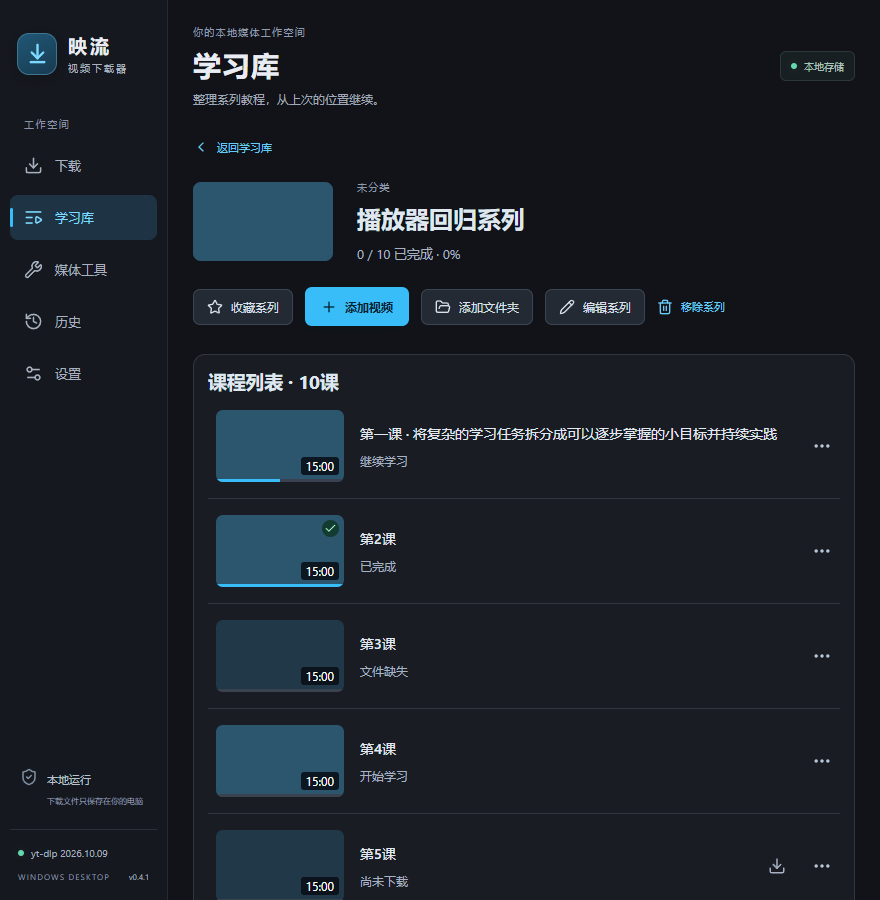
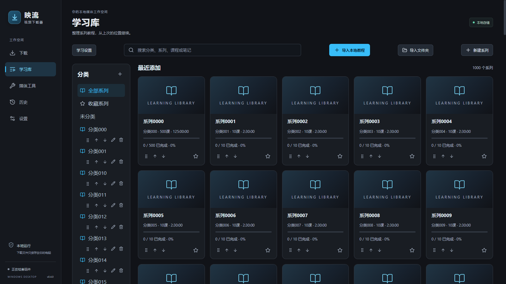

# 映流 Yingliu · 本地视频学习与知识工作台

映流把视频下载、本地学习和 Markdown 知识整理放在一款 Windows 桌面应用中。下载基于官方 **yt-dlp**；学习媒体保留在本机，笔记使用普通 Markdown 文件。

**v0.5.2 高级交互候选版本**：新增命令面板、自定义快捷键、Markdown 实时预览、原生播放器高级控制与自适应工作区、统一任务中心，以及字幕到知识笔记和安全撤销。AI 仍位于对应课程内。见[使用说明](docs/advanced-interactions-v0.5.2.md)和[交付验收](docs/v0.5.2-delivery.md)，包含真实测试范围、安装包校验与人工验收项。

**v0.5.1 工作区候选版本**：修复 AI 引用/总结截断与 Obsidian Vault 联动，新增学习库三视图、播放器布局、统一右键菜单、用途模板、全局外观及布局预设。知识库支持多标签自动保存、历史/收藏/模板/附件、导图、保守富文本与 AI 笔记预览。使用方法见[工作区说明](docs/workspace-v0.5.1.md)、[知识工作台](docs/knowledge-workspace-v0.5.1.md)；真实测试、构建和限制见[交付记录](docs/v0.5.1-delivery.md)。PR 保持 Draft，尚未合并或正式发布安装包。

**v0.5.0 候选版本：AI视频学习与知识库。** AI分析从学习库课程进入，支持语音转录、课程总结、字幕、问答和笔记；知识库用于浏览、编辑、搜索及关联课程内容。自动下载分析默认关闭。版本状态、隐私边界和使用方法见[AI视频分析说明](docs/ai-video-analysis-v0.5.0.md)、[知识库说明](docs/knowledge-vault-v0.5.0.md)与[DeepSeek隐私说明](docs/deepseek-privacy-v0.5.0.md)。真实 DeepSeek 短片验收已通过；安装包和回归范围见[交付记录](docs/ai-video-analysis-delivery.md)。短韩语/拼接中英语音识别存在已记录的质量限制；PR 保持草稿，尚未发布正式 Release。

**v0.4.2 学习播放**：内置 mpv，在映流内直接打开原视频，支持 WMV/MKV/AVI 等格式；保留倍速、字幕、笔记和学习进度。需要时可手动转换兼容视频。[使用与验收记录](docs/native-learning-playback-v0.4.2.md)。

## 日常使用

1. 安装后，从桌面或开始菜单打开「视频下载器」。
2. 粘贴视频、播放列表或分享文本，点 **解析链接**。支持一次解析多个链接。
3. 查看封面、编码和大小，勾选播放列表条目，选择视频 / MP3 音频 / SRT 字幕，加入下载。
4. 默认同时下载 2 个任务，保存到系统「下载」目录的「视频下载」文件夹。可在设置中修改。
5. 下载阶段可暂停后续传；合并与转换阶段可取消。点击已完成任务的播放或文件夹按钮打开文件。

**关闭窗口会进入托盘，后台继续下载。** 双击托盘图标重新打开；右键托盘 →「保存任务并退出」主动退出。下次启动后，未完成任务保持暂停，点击恢复才继续。

快捷键：`Ctrl+L` 定位链接输入；`Ctrl+Enter` 解析；`Esc` 关闭预览并停止解析。删除历史记录会保留下载文件。

## 多格式学习播放与课程图片（v0.4.1）

学习库点击课程后自动选择原始播放、无损封装或H.264/AAC兼容视频，支持WMV/AVI/HEVC等本地素材。课程缩略图在后台生成，支持源站图片离线缓存与手动设置；设置中可查看与清理播放缓存，保留原片、学习进度和笔记。

使用方法见[多格式播放说明](docs/learning-playback-v0.4.1.md)，实现与实机验证见[25项交付报告](docs/learning-playback-v0.4.1-delivery.md)。



## 学习库（v0.4.0）

新建教程分类与系列，导入单个/多个本地视频或文件夹；下载播放列表时勾选“下载后加入学习库”即可建立完整课时目录。视频原路径保留，重复导入会去重。

学习播放器提供字幕、七档倍速、断点续学、90% 自动完成和下一课倒计时。时间点笔记可一键跳转，搜索覆盖笔记与课程；支持收藏和检查系列新增课时。

说明、数据备份和操作细节见[学习库说明](docs/learning-library.md)；测试范围及安装包见[交付与验收](docs/learning-library-delivery.md)。



## 本地媒体工具（v0.2.0）

左侧「媒体工具」支持查看媒体信息、无损封装、H.264/H.265 格式转换、单段裁剪、音频提取和视频截图。选择或拖入一个文件，设置格式与保存位置，再开始处理。默认输出到源文件目录，保留原文件，同名结果自动编号。

媒体队列独立运行，一次处理 1 个任务；支持取消，失败/取消/中断后可重新开始。关闭窗口继续后台处理，主动退出保存为中断，下次手动重新开始。WebM 首版只做兼容源流的无损封装。具体选项、轨道规则与边界见 [媒体工具说明](docs/media-tools.md)。

## 登录、代理与更新

- 默认直接连接，不使用 Cookie。设置页可以读取 Edge / Chrome / Firefox 登录状态。浏览器占用或加密可能使读取失败，错误详情会提示改用文件导入。
- Cookie 文件须为 **Netscape HTTP Cookie File**，UTF-8、小于 2 MiB。导入后由 Windows DPAPI 加密保存；运行内核时临时解密，使用后删除。
- 代理需手动启用并保存，支持 HTTP、HTTPS、SOCKS5，例如 `http://127.0.0.1:7890`。代理凭据同样加密保存。
- 手动检查官方 stable 内核更新；暂停或完成所有解析与下载后再更新。新内核经官方 SHA256 与启动检查后切换，旧版保留用于失败回滚。
- 兼容视频使用官方 `-t mp4` 预设；预览显示实际编码。源站未提供 H.264/AAC 时，选择「源站最高画质」保留原编码。
- 平台可用性继承 yt-dlp，并受到网络、源站登录、地区和权限限制。实际验证结果见 [验收记录](docs/acceptance.md)。

## 从源码运行

需要 Node.js、Rust stable MSVC、Visual Studio C++ 构建工具及 Windows WebView2。依赖锁文件已包含在仓库中。

```powershell
npm ci --ignore-scripts
npm run prepare:tools
npm run tauri -- dev
```

组件准备脚本从固定上游发行地址下载 yt-dlp、FFmpeg/ffprobe、Deno、mpv 和 whisper-cli，**校验固定 SHA256 后才允许打包**。下载使用本机静态系统代理（若存在）；软件内的代理仍默认关闭。所有组件均固定发行地址和 SHA256；mpv 使用来源清单标明的 Windows 构建。校验不匹配时应停止并核对上游摘要。

```powershell
npm test
npm run build
cargo test --manifest-path src-tauri/Cargo.toml --locked
npm run tauri -- build --bundles nsis
```

安装包输出在 `src-tauri/target/release/bundle/nsis/`。安装程序为当前用户安装，中文界面，并在需要时安装 WebView2。

## 文件与许可

设置、加密 Cookie、任务记录和可更新内核保存在 `%LOCALAPPDATA%/com.local.video-downloader/`。任务和设置采用原子 JSON 写入并保留最近一次有效备份。

保存目录中的 `.video-downloader` 存放每个任务的临时文件，用于暂停续传和保护已有文件。取消任务会保留已下载内容；确认不需要继续时可以自行清理对应临时目录。

组件版本、来源与摘要：`src-tauri/resources/components.json`、生成的 `src-tauri/resources/tools/binaries.json`；上游许可：`src-tauri/resources/licenses/`、`src-tauri/resources/THIRD-PARTY-NOTICES.txt`。桌面界面源码采用 MIT；官方 yt-dlp 源码采用 Unlicense，捆绑的 PyInstaller 独立 exe 和 FFmpeg GPL 构建保留各自上游许可。

本地验收可以设置 `VIDEO_DOWNLOADER_DATA_DIR` 将测试数据与日常数据分开；默认无需设置。

## v0.3.0 · Media Pro
新增可视化裁剪、压缩、媒体预设、下载完成动作、GPU回退、字幕、批处理、抽帧、联系表、封面与标签管理。详情见 [使用说明](docs/media-pro.md) 和 [交付验收](docs/media-pro-delivery.md)。
